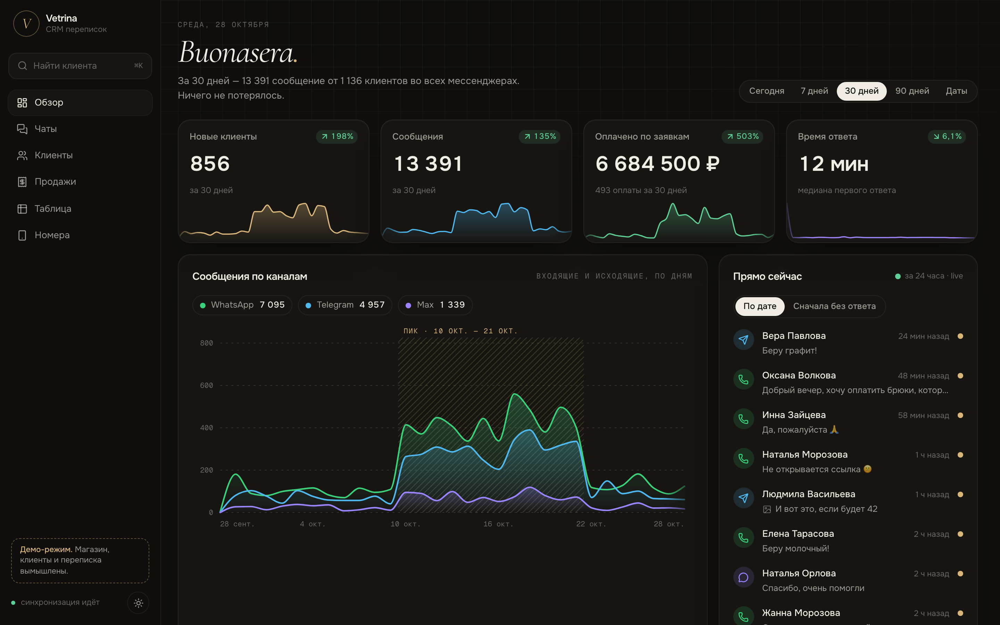
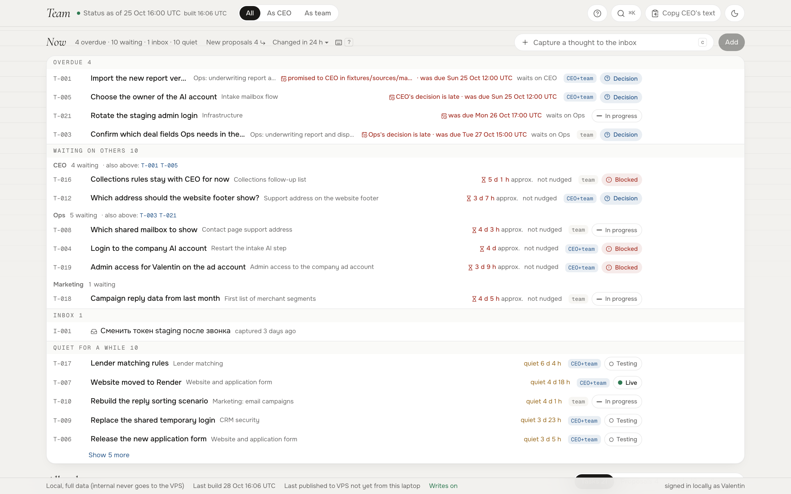

# AI automation: кейсы

Валентин Остапенко, AI automation, Тбилиси.

Захожу в бизнес, разбираюсь, как всё работает на самом деле, и убираю ручную рутину. Делаю весь путь сам: аудит, разработка, деплой, безопасность и объяснение людям простыми словами.

Код из этих проектов, который можно показать:
- [pressable-mcp](https://github.com/OstVale/pressable-mcp) - MCP-сервер к API хостинга Pressable (кейс 2)
- [ops-tools](https://github.com/OstVale/ops-tools) - мониторинг прода и локальная расшифровка созвонов (кейс 1)

## 1. MSFG - технический лид в американской финтех-компании

**Задача.** MSFG - финансирование малого бизнеса. Пришёл как внешний аудитор, с 20 октября работаю full-time техлидом: отвечаю за CRM, сайт, автоматизацию на Make и координацию команды до проверенного прода.

**Что сделал.**
- Аудит репозиториев, хостинга и публичной поверхности.
- Выпустил на прод новую форму заявки /apply с миграцией базы: перед выпуском прогон на той же версии Postgres в Docker, SQL с ON_ERROR_STOP, проверенный откат, синтетическая заявка на проде.
- Поднял мониторинг прода: проверка раз в минуту (HTTP, нужный origin, сертификаты, DNS), алерты и восстановление в Telegram.
- Сделал полный бэкап Make через API (160 blueprint, подключения, хранилища, вебхуки) с вычисткой секретов.
- Расследовал сбой приёма заявок: сверил запуски сценариев и записи, нашёл потерянный кейс и причину (у OpenAI кончились кредиты).
- Настроил DKIM и DMARC, поднял корпоративный сайт после ошибки 500.
- Процесс построил на ИИ-агентах (Claude Code) с жёсткими правилами: реестр фактов о проде с метками проверено/ожидается/неизвестно и источником, два независимых круга ИИ-ревью для кода и документов, утверждения о коде только со ссылкой на тест.
- Сделал внутренний дашборд задач для CEO и команды с правами по ролям и запретом на секреты и персональные данные.
- Записи созвонов расшифровываю локально (Parakeet) и сверяю по ним решения.

**Стек.** Стек клиента: Next.js, Prisma, PostgreSQL на Render, GitLab CI, Cloudflare (DNS и Worker-прокси на 12 маршрутов между сайтом и приложением), Make на 160 сценариев с модулями OpenAI, Google Workspace. Мои инструменты: Claude Code, Docker, Parakeet.

**Результат.** Форма /apply на проде, мониторинг работает. За 11 дней 207 ИИ-ревью нашли около 300 настоящих ошибок до клиента.

## 2. Needlestack - ИИ-обработка клиентских задач в веб-агентстве

**Задача.** Десятки клиентов, 156 сайтов на WordPress. Задачи от клиентов приходят в Asana: правки, лендинги, события, SEO, скорость, плагины, уязвимости, cookie-баннеры.

**Что сделал.**
- Собрал рабочую среду, где ИИ-агенты (Claude Code и Codex) берут задачу из Asana через MCP, читают всю историю и вложения, дают оценку и план, делают правку на сайте по SSH и WP-CLI, снимают скриншот живой страницы с разметкой изменений (Puppeteer) и отчитываются в задаче. Время сверяется с Harvest через API.
- Правила: бэкап перед правкой, сначала только чтение, dry run для скриптов, доступы через обёртки без вывода ключей, остановка при перерасходе бюджета.
- Написал свой MCP-сервер к API хостинга Pressable (37 инструментов, режим только чтения, удаление только с подтверждением) - [pressable-mcp](https://github.com/OstVale/pressable-mcp).
- Повторяющиеся задачи оформил в навыки агента.
- Второй слой: система приёма запросов из общего почтового ящика. Мониторинг SLA, метки зависших писем, ИИ-разбор запроса в черновик задачи для PM. Проверял на 162 прошлых парах "письмо и бриф от человека" и выяснил, что уверенности модели верить нельзя, поэтому добавил правила-стопы и ИИ-ревьюера.

**Стек.** Claude Code, Codex, MCP, Asana, SSH, WP-CLI, Puppeteer, Harvest API, Pressable API. Для почты: Missive, Google Apps Script, Gemini.

**Результат.**
- MCP-сервером проверил все 156 сайтов и нашёл 133 уязвимые установки плагинов на 107 сайтах, включая одну критическую.
- Настройка Complianz целиком через WP-CLI теперь около 50 минут вместо 5+ часов руками.
- Мониторинг почты и передача задач работают, автосоздание задач пока в тестовом режиме, ждёт решения агентства.
- По замеру на 274 задачах за 90 дней примерно 20% запросов можно вести по быстрому пути.

## 3. MOLECOLA - CRM переписок для магазина в Италии

**Задача.** Менеджеры продают из личных WhatsApp, Telegram и Max, и при блокировке номера теряется вся база.

**Что сделал.** CRM, которая молча копирует всю переписку в одну базу, а менеджеры работают как раньше.
- Для каждого мессенджера свой адаптер в общий формат. Telegram через Business-бота и Telethon для истории с докачкой и обработкой лимитов, WhatsApp через WAHA с подписанными вебхуками, Max через GREEN-API.
- Удалённые и отредактированные сообщения сохраняются.
- Склейка клиентов по номеру из разных каналов с журналом слияний.
- Вход в Telegram-сессию по QR прямо из CRM, облачный пароль нигде не сохраняется.
- Демо-режим на вымышленных данных, который не стартует с реальной базой.
- ИИ: модель читает последние сообщения и в строгом JSON решает, ждёт ли клиент ответа, утром менеджеру приходит сводка в Telegram. Есть дневной лимит в рублях, маскировка телефонов и запасной провайдер: когда агрегатор закрыл доступ к Claude, переехали на другую модель за 20 минут.
- Учёт продаж по переписке: чеки из PDF и OCR скриншотов.

**Стек.** Около 20 тысяч строк Python (FastAPI, Postgres, 18 миграций, около 650 тестов), фронт на React, медиа в S3, Docker на VPS в РФ.

**Результат.** Работает на проде.
- Импортировал 155 тысяч сообщений и около 15 ГБ медиа из 3 876 чатов.
- На 150 размеченных боевых примерах правила дали точность 0,86, модель 0,94-0,96.
- Сверка учёта продаж с таблицей клиента совпала на 89-90%.

## Ещё

- Система аутрича с ИИ для UGC-креатора: сбор отелей и контактов, письма от Opus, разбор ответов Haiku, учёт цены каждого вызова модели.
- Telegram-бот с Mini App для подсчёта КБЖУ по фото и голосу.
- Интеграция Pipedrive, n8n и Maileon для немецкого производителя (1180 контактов без ошибок).

## Скриншоты

Скриншоты будут добавлены позже.

